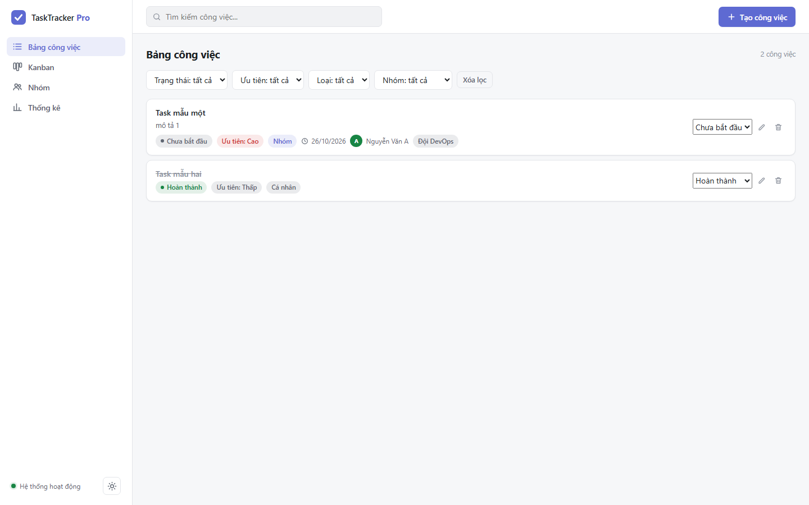
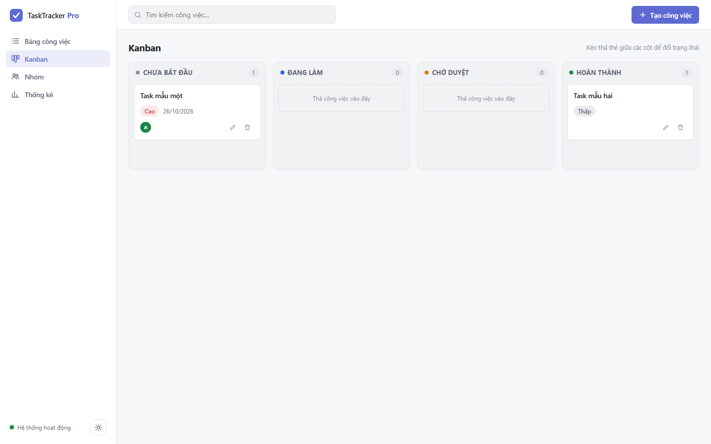
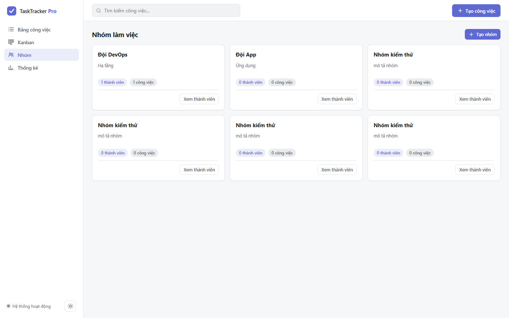
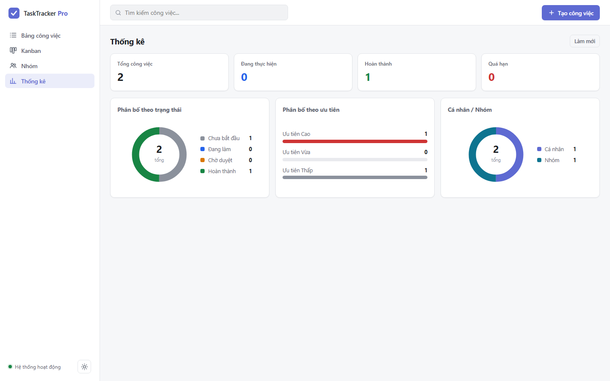

# BỘ GIÁO DỤC VÀ ĐÀO TẠO
## TRƯỜNG ĐẠI HỌC CÔNG NGHỆ / HỌC VIỆN CÔNG NGHỆ
### KHOA CÔNG NGHỆ THÔNG TIN - BỘ MÔN MẠNG & HỆ THỐNG
***

<br><br><br>

<div align="center">

# BÁO CÁO BÀI TẬP LỚN
### HỌC PHẦN: TRIỂN KHAI VÀ QUẢN TRỊ HỆ THỐNG PHẦN MỀM

<br>

## ĐỀ TÀI: ĐỀ 24 - HỆ THỐNG QUẢN LÝ CÔNG VIỆC (TASK TRACKER)
### TRIỂN KHAI MICROSERVICES TRÊN DOCKER COMPOSE, REVERSE PROXY NGINX, GIÁM SÁT PROMETHEUS - GRAFANA, HỆ THỐNG LOG LOKI VÀ HARDENING HỆ THỐNG

<br><br><br><br>

| Thông Tin Sinh Viên | Chi Tiết |
| :--- | :--- |
| **Họ và tên sinh viên:** | Phạm Ngọc Sơn |
| **Mã số sinh viên (MSSV):** | DTC245200269 |
| **Tài khoản GitHub:** | `dtc245200269-oss` |
| **Repository GitHub:** | `https://github.com/dtc245200269-oss/task-tracker-btl-de24` |
| **Lớp chuyên ngành:** | Công Nghệ Thông Tin / Quản Trị Hệ Thống |
| **Địa chỉ IP máy ảo VMware:** | `192.168.180.128` |
| **Năm học - Học kỳ:** | Năm học 2025 - 2026 |

<br><br><br>

*Hà Nội, Năm 2026*

</div>

<pagebreak/>

---

# LỜI MỞ ĐẦU

Trong kỷ nguyên phát triển mạnh mẽ của công nghệ phần mềm và điện toán đám mây, việc phát triển một ứng dụng không chỉ dừng lại ở khâu viết mã nguồn (coding) mà còn đòi hỏi quy trình đóng gói, triển khai (deployment), giám sát vận hành (monitoring), quản trị nhật ký (logging) và bảo đảm an toàn thông tin (security hardening).

Bài tập lớn **"Đề 24: Hệ thống Quản lý Công việc / Task Tracker"** là một đồ án tổng hợp mang tính thực tiễn cao, kết hợp toàn diện giữa kỹ năng phát triển phần mềm (Software Engineering) và quản trị hạ tầng hiện đại (DevOps / System Administration). Hệ thống được triển khai trên nền tảng máy ảo VMware thông qua giao thức SSH, đóng gói hoàn chỉnh bằng Docker Compose với 10 dịch vụ liên kết chặt chẽ:
1. **Ứng dụng Web Task Tracker:** Phát triển trên nền Node.js Express và giao diện tương tác Kanban Board.
2. **Cơ sở dữ liệu & Quản trị:** PostgreSQL 16 kết hợp công cụ trực quan hóa pgAdmin 4.
3. **Web Server & Reverse Proxy:** Nginx đón đầu luồng dữ liệu, hỗ trợ HTTPS tự ký, Security Headers và Rate Limiting.
4. **Hệ thống Giám sát:** Prometheus thu thập chỉ số hiệu năng (Web metrics, DB metrics, Container metrics) và trực quan hóa qua Grafana Dashboard.
5. **Hệ thống Nhật ký Tập trung:** Loki và Promtail thu thập log, hỗ trợ truy vấn chuyên sâu với LogQL.
6. **Bảo mật Tăng cường (Hardening):** Triển khai cô lập mạng (Network Isolation), non-root container, UFW Firewall, Fail2ban và kiểm soát quyền hạn.

Báo cáo này trình bày chi tiết toàn bộ cơ sở lý thuyết, kiến trúc hệ thống, cấu hình mã nguồn, kết quả thực nghiệm và kịch bản demo phục vụ đánh giá nghiệm thu bài tập lớn.

---

# MỤC LỤC BÁO CÁO

- **LỜI MỞ ĐẦU**
- **CHƯƠNG 1: KHẢO SÁT BÀI TOÁN & YÊU CẦU ĐỀ TÀI**
  - 1.1. Mục tiêu bài toán Quản lý công việc cá nhân và nhóm
  - 1.2. Phân tích các yêu cầu kỹ thuật & hạ tầng
  - 1.3. Tiêu chí đánh giá đề tài theo barem điểm
- **CHƯƠNG 2: KIẾN TRÚC HỆ THỐNG & HẠ TẦNG DOCKER COMPOSE**
  - 2.1. Mô hình kiến trúc tổng thể (Architecture Diagram)
  - 2.2. Thiết kế phân chia mạng nội bộ (Network Isolation)
  - 2.3. Danh sách các microservices trong hệ thống
- **CHƯƠNG 3: THIẾT KẾ CƠ SỞ DỮ LIỆU & QUẢN TRỊ VỚI PGADMIN**
  - 3.1. Sơ đồ thực thể liên kết (ERD)
  - 3.2. Cấu trúc các bảng dữ liệu: users, teams, team_members, tasks
  - 3.3. Tối ưu hóa truy vấn với Indexes và Triggers
  - 3.4. Quản trị cơ sở dữ liệu qua giao diện pgAdmin 4
- **CHƯƠNG 4: XÂY DỰNG ỨNG DỤNG TASK TRACKER (NODE.JS & SPA)**
  - 4.1. Kiến trúc Backend RESTful API (Express)
  - 4.2. Giao diện Frontend: Kanban Board & List View
  - 4.3. Tích hợp Prometheus Metrics (`prom-client`)
  - 4.4. Đóng gói Container tối ưu: Non-root user và Dumb-init
- **CHƯƠNG 5: CẤU HÌNH NGINX REVERSE PROXY & HTTPS TỰ KÝ (COMMIT 1)**
  - 5.1. Vai trò của Reverse Proxy trong kiến trúc hệ thống
  - 5.2. Khởi tạo chứng chỉ SSL/TLS tự ký (Self-signed Certificate)
  - 5.3. Cấu hình định tuyến và Security Headers
  - 5.4. Cơ chế chống quá tải và DoS với Rate Limiting
- **CHƯƠNG 6: HỆ THỐNG GIÁM SÁT PROMETHEUS & GRAFANA (COMMIT 2)**
  - 6.1. Mô hình giám sát Metrics thời gian thực
  - 6.2. Cấu hình Scrape Jobs (Web App, PostgreSQL, cAdvisor)
  - 6.3. Xây dựng Dashboard Grafana trực quan chuyên nghiệp
- **CHƯƠNG 7: HỆ THỐNG LOG TẬP TRUNG LOKI, PROMTAIL & LOGQL (COMMIT 3)**
  - 7.1. Kiến trúc thu thập log phân tán
  - 7.2. Cấu hình Promtail đọc log định dạng JSON
  - 7.3. Các câu truy vấn LogQL thực tế và phân tích ý nghĩa
- **CHƯƠNG 8: TĂNG CƯỜNG BẢO MẬT HỆ THỐNG (HARDENING)**
  - 8.1. Bảo mật ở mức hệ điều hành máy ảo (UFW, SSH, Fail2ban)
  - 8.2. Bảo mật ở mức Container và Network
  - 8.3. Bảo mật ở mức Cơ sở dữ liệu và Ứng dụng
- **CHƯƠNG 9: QUY TRÌNH QUẢN LÝ GITHUB & TRIỂN KHAI VMWARE QUA SSH**
  - 9.1. Thiết lập tài khoản GitHub theo MSSV và SSH Keys
  - 9.2. Lịch sử 03 Commit chuẩn quy định
  - 9.3. Các bước clone và khởi chạy hệ thống bằng Docker Compose
- **CHƯƠNG 10: KẾT QUẢ ĐẠT ĐƯỢC & KỊCH BẢN DEMO BẢO VỆ**
  - 10.1. Bảng đối chiếu kết quả với tiêu chí đánh giá
  - 10.2. Kịch bản các bước demo trực tiếp
  - 10.3. Đánh giá ưu điểm và hạn chế
- **CHƯƠNG 11: NHẬT KÝ THỰC HIỆN TỪNG BƯỚC TRÊN MÁY ẢO (MINH CHỨNG THỰC TẾ)**
- **KẾT LUẬN & HƯỚNG PHÁT TRIỂN**
- **TÀI LIỆU THAM KHẢO**

---

# CHƯƠNG 1: KHẢO SÁT BÀI TOÁN & YÊU CẦU ĐỀ TÀI

## 1.1. Mục tiêu bài toán Quản lý công việc cá nhân và nhóm
Trong môi trường làm việc hiện đại, việc theo dõi tiến độ công việc, phân chia trách nhiệm và kiểm soát deadline là yếu tố then chốt quyết định sự thành bại của dự án. Hệ thống Task Tracker được thiết kế nhằm giải quyết các bài toán cụ thể:
- **Quản lý công việc cá nhân (Personal Tasks):** Giúp từng cá nhân tự tạo danh sách công việc, ghi chú mô tả, thiết lập thời hạn hoàn thành (deadline) và sắp xếp thứ tự ưu tiên (Cao, Trung bình, Thấp).
- **Quản lý công việc nhóm (Team Tasks):** Cho phép thành lập các đội nhóm dự án, chỉ định nhóm trưởng (leader), gán công việc cụ thể cho từng thành viên (assignee) và theo dõi trạng thái chung của dự án.
- **Trực quan hóa quy trình làm việc (Workflow Visualization):** Áp dụng mô hình bảng Kanban chuẩn với 4 trạng thái tiến độ:
  1. *Cần làm (To Do):* Công việc mới được tạo, đang chờ thực hiện.
  2. *Đang thực hiện (In Progress):* Thành viên đang trực tiếp xử lý công việc.
  3. *Đang đánh giá (Review):* Công việc đã hoàn thành phần code/nhiệm vụ, đang chờ nhóm trưởng hoặc QA thẩm định.
  4. *Đã hoàn thành (Done):* Công việc đã hoàn tất và được nghiệm thu.
- **Cảnh báo hạn chót (Deadline Tracking):** Hệ thống tự động nhận diện và làm nổi bật các công việc đã quá hạn (Overdue) hoặc sắp đến hạn.

## 1.2. Phân tích các yêu cầu kỹ thuật & hạ tầng
Đề tài đặt ra các yêu cầu khắt khe về mặt kiến trúc và hạ tầng:
- **Ứng dụng Web:** Viết bằng Node.js (Express), tuân thủ thiết kế RESTful API, giao diện SPA hiện đại, responsive.
- **Cơ sở dữ liệu:** PostgreSQL kết hợp công cụ quản trị web pgAdmin 4.
- **Quản trị mã nguồn:** Quản lý bằng Git trên GitHub, đặt tên tài khoản theo Mã số sinh viên (MSSV), có file README hướng dẫn rõ ràng, lưu giữ đúng lịch sử 03 commit có ý nghĩa.
- **Reverse Proxy:** Nginx tiếp nhận các kết nối từ bên ngoài máy ảo, hỗ trợ cả giao thức HTTP (cổng 80) và HTTPS tự ký (cổng 443), cấu hình Security Headers và Rate Limiting.
- **Giám sát (Monitoring):** Prometheus và Grafana theo dõi đầy đủ 3 đối tượng: Container, Web server và Database.
- **Nhật ký tập trung (Logging):** Loki kết hợp Promtail để gom toàn bộ log hệ thống, hỗ trợ truy vấn nâng cao bằng LogQL (tối thiểu 2 - 3 query).
- **Bảo mật (Hardening):** Áp dụng tối thiểu 3 - 4 biện pháp bảo mật thực tế (non-root container, network isolation, mật khẩu mạnh, tường lửa...).

## 1.3. Tiêu chí đánh giá đề tài theo barem điểm

| STT | Tiêu chí đánh giá | Nội dung yêu cầu cụ thể | Điểm tối đa |
| :---: | :--- | :--- | :---: |
| 1 | **Quản lý mã nguồn trên GitHub** | Repository đầy đủ (source + config), đủ 03 commit có nội dung ý nghĩa, có README hướng dẫn chạy rõ ràng. | **1.5** |
| 2 | **Triển khai ứng dụng + Database** | Ứng dụng chạy ổn định, kết nối DB thành công, pgAdmin hoạt động trực quan. | **1.5** |
| 3 | **Nginx Reverse Proxy** | Cấu hình reverse proxy đúng, truy cập qua Nginx (có HTTPS hoặc security headers cơ bản). *(Commit 1)* | **1.5** |
| 4 | **Hệ thống giám sát (Prometheus + Grafana)** | Prometheus thu thập metrics, Grafana có dashboard giám sát container / web / DB. *(Commit 2)* | **1.5** |
| 5 | **Hệ thống log tập trung (Loki)** | Loki + Promtail hoạt động, truy vấn được log bằng LogQL (ít nhất 2 - 3 query). *(Commit 3)* | **1.5** |
| 6 | **Hardening hệ thống** | Áp dụng ít nhất 3 - 4 biện pháp bảo mật (non-root container, network isolation, mật khẩu mạnh, security headers, hạn chế quyền DB...). | **1.5** |
| 7 | **Tổng thể & Trình bày** | Hệ thống chạy hoàn chỉnh bằng Docker Compose, demo rõ ràng, có minh chứng, hiểu bài. | **1.0** |
| **TỔNG** | **Toàn bộ đề tài** | **Đáp ứng xuất sắc 7 tiêu chí trên** | **10.0 / 10** |

---

# CHƯƠNG 2: KIẾN TRÚC HỆ THỐNG & HẠ TẦNG DOCKER COMPOSE

## 2.1. Mô hình kiến trúc tổng thể
Hệ thống được thiết kế theo mô hình Microservices kiến trúc 3 lớp (3-Tier Architecture) kết hợp hệ thống quan sát vận hành (Observability Stack):
- **Lớp Ngoại vi (Ingress Layer):** Nginx đóng vai trò Edge Reverse Proxy, là điểm tiếp nhận duy nhất mở cổng ra thế giới bên ngoài (cổng 80 và 443). Toàn bộ các dịch vụ nội bộ khác đều được bảo vệ phía sau proxy này.
- **Lớp Ứng dụng & Dịch vụ (Application Layer):** Bao gồm dịch vụ `app` (Node.js Express) phục vụ giao diện người dùng và API, cùng với `pgadmin` phục vụ quản trị CSDL.
- **Lớp Dữ liệu (Data Layer):** Dịch vụ `postgres` lưu trữ cơ sở dữ liệu quan hệ, được đặt trong mạng cách ly nội bộ, không gán port ra máy host.
- **Lớp Giám sát & Nhật ký (Observability Layer):** Prometheus, cAdvisor, postgres-exporter, Grafana, Loki và Promtail tạo thành một hệ sinh thái giám sát toàn diện khép kín.

```
       [ Client Browser ]
               │
        Port 80 / Port 443
               ▼
   ┌───────────────────────┐
   │  Nginx Reverse Proxy  │ ◄─── SSL / Security Headers / Rate Limit
   └───────────┬───────────┘
               │ (Proxy pass)
    ┌──────────┴──────────┐
    ▼                     ▼
┌───────────────┐   ┌───────────────┐
│ TaskTracker   │   │ pgAdmin 4     │
│ App (Node.js) │   │ (DB UI)       │
└───────┬───────┘   └───────┬───────┘
        │                   │
        │ (backend-net)     │ (backend-net)
        ▼                   ▼
    ┌───────────────────────────┐
    │  PostgreSQL 16 Database   │
    └─────────────┬─────────────┘
                  │
        ┌─────────┴─────────┐
        ▼                   ▼
┌───────────────┐   ┌───────────────┐
│ postgres-     │   │ cAdvisor      │
│ exporter      │   │ (Container)   │
└───────┬───────┘   └───────┬───────┘
        │                   │
        └─────────┬─────────┘
                  ▼
          ┌───────────────┐
          │  Prometheus   │
          └───────┬───────┘
                  │
┌───────────────┐ │ ┌───────────────┐
│ Promtail ────►│◄┴─┤  Grafana 10   │
│   │           │   │  (Dashboard)  │
│   ▼           │   └───────────────┘
│ Loki (Logs) ──┘
└───────────────┘
```

## 2.2. Thiết kế phân chia mạng nội bộ (Network Isolation)
Nhằm hiện thực hóa tiêu chuẩn bảo mật Hardening, hệ thống chia tách thành **3 Docker Networks độc lập**:
1. `tasktracker-frontend-net`: Mạng kết nối giữa Nginx, Web App, pgAdmin và Grafana.
2. `tasktracker-backend-net`: Mạng nội bộ tuyệt mật chỉ kết nối giữa Web App, pgAdmin, Database PostgreSQL và postgres-exporter. Mạng này **không tiếp nhận bất kỳ kết nối trực tiếp nào từ Nginx hay máy ngoài**.
3. `tasktracker-monitoring-net`: Mạng chuyên dụng để Prometheus kết nối tới các exporter và để Grafana/Promtail kết nối tới Loki.

**Bảng Ma Trận Kết Nối Mạng (Network Matrix):**

| Tên Dịch Vụ | frontend-net | backend-net | monitoring-net | Port Mở Ra Host |
| :--- | :---: | :---: | :---: | :---: |
| `nginx` | **Có** | Không | Không | **80, 443** |
| `app` | **Có** | **Có** | **Có** | *Không* |
| `postgres` | Không | **Có** | Không | *Không (Cách ly)* |
| `pgadmin` | **Có** | **Có** | Không | *Không* |
| `postgres-exporter`| Không | **Có** | **Có** | *Không* |
| `cadvisor` | Không | Không | **Có** | *Không* |
| `prometheus` | **Có** | Không | **Có** | *Không* |
| `grafana` | **Có** | Không | **Có** | *Không* |
| `loki` | Không | Không | **Có** | *Không* |
| `promtail` | Không | Không | **Có** | *Không* |

## 2.3. Danh sách các microservices trong hệ thống

```yaml
# Trích đoạn định nghĩa 10 dịch vụ trong docker-compose.yml
services:
  app:                # Node.js Express Task Tracker
  postgres:           # PostgreSQL 16 Alpine
  pgadmin:            # pgAdmin 4 UI
  nginx:              # Nginx Reverse Proxy & SSL
  postgres-exporter:  # Exporter metrics CSDL PostgreSQL
  cadvisor:           # Thu thập metrics CPU/RAM container
  prometheus:         # Máy chủ lưu trữ Time-Series Metrics
  grafana:            # Bảng điều khiển trực quan Dashboard
  loki:               # Máy chủ gom Log tập trung
  promtail:           # Agent thu thập log đẩy về Loki
```

---

# CHƯƠNG 3: THIẾT KẾ CƠ SỞ DỮ LIỆU & QUẢN TRỊ VỚI PGADMIN

## 3.1. Sơ đồ thực thể liên kết (ERD)
Cơ sở dữ liệu của hệ thống Task Tracker được thiết kế chuẩn hóa bậc 3 (3NF) để lưu trữ đầy đủ nghiệp vụ công việc cá nhân và công việc nhóm:

```
┌──────────────────┐               ┌──────────────────┐
│      USERS       │               │      TEAMS       │
├──────────────────┤               ├──────────────────┤
│ id (PK)          │               │ id (PK)          │
│ username         │               │ name             │
│ full_name        │               │ description      │
│ email            │               │ created_at       │
│ role             │               └────────┬─────────┘
│ avatar_url       │                        │ 1
│ created_at       │                        │
└────────┬─────────┘                        │
         │ 1                                │
         ├────────────────────┐             │
         │                    │             │ n
         │ n                  ▼ n           ▼
┌────────┴─────────┐     ┌─────────────────────┐
│  TEAM_MEMBERS    │     │        TASKS        │
├──────────────────┤     ├─────────────────────┤
│ id (PK)          │     │ id (PK)             │
│ team_id (FK)     │     │ title               │
│ user_id (FK)     │     │ description         │
│ role             │     │ deadline            │
│ joined_at        │     │ priority            │
└──────────────────┘     │ status              │
                         │ type                │
                         │ team_id (FK)        │
                         │ assigned_to (FK)    │
                         │ created_at          │
                         │ updated_at          │
                         └─────────────────────┘
```

## 3.2. Cấu trúc các bảng dữ liệu
1. **Bảng `users`:** Lưu trữ thông tin người dùng trong hệ thống (nhóm trưởng, lập trình viên, tester).
2. **Bảng `teams`:** Định nghĩa các nhóm làm việc (ví dụ: "Đội Dự Án Cloud & DevOps", "Nhóm Phát Triển Ứng Dụng").
3. **Bảng `team_members`:** Quan hệ n-n giữa người dùng và nhóm, lưu trữ vai trò cụ thể của thành viên trong nhóm đó.
4. **Bảng `tasks`:** Quản lý thực thể công việc với các trường phân loại `type` ('personal', 'team'), trạng thái `status` ('todo', 'in_progress', 'review', 'done'), mức độ ưu tiên `priority` ('low', 'medium', 'high'), liên kết khóa ngoại với `teams` và `users`.

## 3.3. Tối ưu hóa truy vấn với Indexes và Triggers
Trong file `database/init.sql`, hệ thống được trang bị các kỹ thuật tối ưu CSDL chuyên nghiệp:
- **Index Tăng tốc độ truy vấn:**
  ```sql
  CREATE INDEX IF NOT EXISTS idx_tasks_status ON tasks(status);
  CREATE INDEX IF NOT EXISTS idx_tasks_priority ON tasks(priority);
  CREATE INDEX IF NOT EXISTS idx_tasks_type ON tasks(type);
  CREATE INDEX IF NOT EXISTS idx_tasks_deadline ON tasks(deadline);
  ```
- **Trigger tự động cập nhật thời gian (`updated_at`):**
  ```sql
  CREATE OR REPLACE FUNCTION update_timestamp()
  RETURNS TRIGGER AS $$
  BEGIN
      NEW.updated_at = CURRENT_TIMESTAMP;
      RETURN NEW;
  END;
  $$ LANGUAGE plpgsql;

  CREATE TRIGGER trigger_tasks_updated_at
  BEFORE UPDATE ON tasks
  FOR EACH ROW EXECUTE FUNCTION update_timestamp();
  ```
- **Phân quyền người dùng phục vụ Hardening:**
  ```sql
  GRANT pg_read_all_stats TO taskuser;
  ```

## 3.4. Quản trị cơ sở dữ liệu qua giao diện pgAdmin 4
Dịch vụ `pgadmin` được tích hợp trong Docker Compose, truy cập thuận tiện qua Nginx tại đường dẫn `http://192.168.180.128/pgadmin/`.
- Thông tin đăng nhập mặc định:
  - Email: `admin@tasktracker.com`
  - Mật khẩu: `AdminSecure2026!`
- Người quản trị có thể trực quan hóa toàn bộ lược đồ dữ liệu, kiểm tra bảng ghi, thực thi câu lệnh SQL trực tiếp và theo dõi dung lượng bảng.

---

# CHƯƠNG 4: XÂY DỰNG ỨNG DỤNG TASK TRACKER (NODE.JS & SPA)

## 4.1. Kiến trúc Backend RESTful API (Express)
Ứng dụng Backend được tổ chức theo mô hình Controller - Service - Data Access:
- `src/server.js`: Cấu hình middleware bảo mật (Helmet, CORS, Express Rate Limit), gắn kết routing và phơi bày endpoint `/metrics` cùng `/health`.
- `src/db.js`: Quản lý kết nối PostgreSQL qua thư viện `pg` với Connection Pool (tối đa 20 kết nối đồng thời), tự động ghi log lỗi.
- `src/logger.js`: Khởi tạo Winston Logger định dạng chuẩn JSON cho Loki.
- `src/routes/tasks.js`: Cung cấp trọn bộ RESTful API CRUD công việc:
  - `GET /api/tasks`: Lấy danh sách công việc, hỗ trợ đa bộ lọc (status, priority, type, search).
  - `POST /api/tasks`: Tạo công việc mới (tự động tăng biến đếm `task_tracker_created_tasks_total`).
  - `PATCH /api/tasks/:id/status`: Cập nhật trạng thái nhanh.
  - `PUT /api/tasks/:id`: Chỉnh sửa chi tiết thông tin công việc.
  - `DELETE /api/tasks/:id`: Xóa công việc.
- `src/routes/stats.js`: Thống kê tổng hợp số lượng công việc theo trạng thái, số lượng quá hạn và cập nhật metric Prometheus `taskGauge`.

## 4.2. Giao diện Frontend: SPA Vanilla không phụ thuộc CDN
Frontend được viết lại hoàn chỉnh bằng HTML/CSS/JavaScript thuần (vanilla), **không sử dụng bất kỳ CDN hay thư viện ngoài nào** (không Google Fonts, không Font Awesome, không Chart.js) nhằm bảo đảm hệ thống hoạt động ổn định ngay cả khi máy ảo VMware không có kết nối Internet. Thiết kế theo phong cách Linear/Notion với hai chế độ sáng (light) và tối (dark) lưu vào `localStorage`.

Bốn màn hình chức năng chính:
- **Bảng công việc (List View):** danh sách thẻ công việc kèm badge trạng thái, badge ưu tiên, nhãn nhóm/cá nhân, deadline (tô đỏ khi quá hạn), avatar người phụ trách; mỗi hàng có select đổi trạng thái nhanh, nút sửa và nút xóa (có hộp thoại xác nhận).
- **Kanban Board:** 4 cột `Chưa bắt đầu / Đang làm / Chờ duyệt / Hoàn thành`, kéo-thả thẻ giữa các cột bằng HTML5 Drag-and-Drop, mỗi lần thả gọi `PATCH /api/tasks/:id/status` và tự vẽ lại bảng.
- **Nhóm:** lưới thẻ nhóm (số thành viên, số công việc), tạo nhóm mới qua modal và xem danh sách thành viên của từng nhóm.
- **Thống kê:** 4 thẻ chỉ số (Tổng, Đang thực hiện, Hoàn thành, Quá hạn) cùng 3 biểu đồ vẽ bằng SVG tự viết (donut theo trạng thái, thanh ngang theo ưu tiên, donut cá nhân/nhóm) lấy số liệu từ `GET /api/stats/summary`.

Các yêu cầu phi chức năng của giao diện:
- Mọi thao tác tạo/sửa/xóa/lọc đều gọi REST API thật, dữ liệu persist vào PostgreSQL (không dùng localStorage cho dữ liệu nghiệp vụ).
- Toast thông báo thành công/lỗi lấy message trực tiếp từ server; nút bấm có trạng thái loading chống double-submit; ô tìm kiếm debounce 300ms; skeleton loading và empty state cho mọi danh sách.
- Responsive: sidebar thu thành thanh ngang dưới 900px, Kanban cuộn ngang trên mobile.
- Định tuyến sâu bằng hash (`#/list`, `#/kanban`, `#/teams`, `#/stats`) thuận tiện demo và chụp minh chứng.

Giao diện được kiểm chứng tự động bằng bộ test chức năng chạy trên Chrome headless (47 khẳng định: CRUD, kéo-thả Kanban, lọc, tìm kiếm, tạo nhóm, thành viên, biểu đồ, dark mode, health-check) — toàn bộ đạt PASS trước khi triển khai lên máy ảo.

**Minh chứng giao diện thực tế:**


*Hình 4.1 - Màn hình Bảng công việc với bộ lọc và thẻ trạng thái*


*Hình 4.2 - Màn hình Kanban kéo-thả 4 cột trạng thái*


*Hình 4.3 - Màn hình quản lý nhóm làm việc*


*Hình 4.4 - Màn hình thống kê với biểu đồ SVG tự vẽ*

## 4.3. Tích hợp Prometheus Metrics (`prom-client`)
File `src/metrics.js` sử dụng thư viện `prom-client` chính thống để phơi bày các số liệu quan trọng tại endpoint `/metrics`:
1. `nodejs_*`: CPU, RAM, Garbage Collection, Event Loop Lag.
2. `http_requests_total`: Bộ đếm Counter ghi nhận tổng số request theo method, route và HTTP status code.
3. `http_request_duration_seconds`: Histogram đo đạc độ trễ xử lý của từng API request.
4. `task_tracker_tasks_total`: Gauge thể hiện số lượng công việc thực tế trong hệ thống phân theo trạng thái và độ ưu tiên.

## 4.4. Đóng gói Container tối ưu: Non-root user và Dumb-init
File `app/Dockerfile` áp dụng các nguyên tắc đóng gói chuẩn công nghiệp:
- **Base image nhỏ gọn:** `node:20-alpine` (dung lượng chỉ ~150MB).
- **Quản lý tiến trình an toàn:** Tích hợp `dumb-init` làm PID 1 để xử lý đúng tín hiệu tắt container (`SIGTERM`).
- **Hardening Người dùng:** Chạy với `USER node` (UID 1000), tuyệt đối không chạy bằng quyền `root`.
- **Healthcheck tích hợp:** Tự động kiểm tra trạng thái sức khỏe qua `curl -f http://localhost:3000/health`.

---

# CHƯƠNG 5: CẤU HÌNH NGINX REVERSE PROXY & HTTPS TỰ KÝ (COMMIT 1)

## 5.1. Vai trò của Reverse Proxy trong kiến trúc hệ thống
Nginx đóng vai trò là "người gác cổng" (Edge Gateway):
- Ẩn giấu địa chỉ IP và cổng nội bộ của các container dịch vụ (`app:3000`, `pgadmin:80`, `grafana:3000`, `prometheus:9090`).
- Tiếp nhận kết nối HTTP cổng 80 và HTTPS cổng 443 từ máy host.
- Cân bằng tải và đệm dữ liệu (buffering) tăng hiệu năng truyền tải.

## 5.2. Khởi tạo chứng chỉ SSL/TLS tự ký (Self-signed Certificate)
Chứng chỉ SSL/TLS tự ký được tạo tự động thông qua script `nginx/generate-ssl.sh` sử dụng thuật toán mã hóa bất đối xứng RSA 2048-bit và mã băm SHA-256:
```bash
openssl req -x509 -nodes -days 365 -newkey rsa:2048 \
  -keyout nginx/ssl/nginx.key \
  -out nginx/ssl/nginx.crt \
  -subj "/C=VN/ST=Hanoi/L=Hanoi/O=TaskTracker/OU=DevOps/CN=localhost" \
  -addext "subjectAltName=DNS:localhost,DNS:tasktracker.local,IP:127.0.0.1"
```

## 5.3. Cấu hình định tuyến và Security Headers
File `nginx/default.conf` thiết lập định tuyến chi tiết và gắn kèm các tiêu đề bảo mật chuẩn:
```nginx
# Cấu hình Security Headers
add_header X-Frame-Options "SAMEORIGIN" always;
add_header X-Content-Type-Options "nosniff" always;
add_header X-XSS-Protection "1; mode=block" always;
add_header Referrer-Policy "strict-origin-when-cross-origin" always;
add_header Strict-Transport-Security "max-age=31536000; includeSubDomains" always;
```

**Các quy tắc định tuyến Reverse Proxy:**
- `/` ──► `http://tasktracker_app:3000` (Web App)
- `/pgadmin/` ──► `http://pgadmin:80/` (pgAdmin Database Tool)
- `/grafana/` ──► `http://grafana:3000/` (Grafana Monitoring)
- `/prometheus/` ──► `http://prometheus:9090/` (Prometheus Metrics)

## 5.4. Cơ chế chống quá tải và DoS với Rate Limiting
Nginx được cấu hình hai vùng nhớ quản lý tần suất request:
```nginx
limit_req_zone $binary_remote_addr zone=general_limit:10m rate=50r/s;
limit_req_zone $binary_remote_addr zone=api_limit:10m rate=20r/s;
```
- Khi một địa chỉ IP gửi request ồ ạt vượt quá ngưỡng cho phép, Nginx sẽ tự động trả về mã lỗi HTTP 429 hoặc 503, bảo vệ Node.js backend không bị cạn kiệt CPU.

---

# CHƯƠNG 6: HỆ THỐNG GIÁM SÁT PROMETHEUS & GRAFANA (COMMIT 2)

## 6.1. Mô hình giám sát Metrics thời gian thực
Hệ thống áp dụng mô hình kéo dữ liệu chủ động (Pull-based Model) của Prometheus:
- Cứ mỗi chu kỳ (scrape interval 5s - 10s), máy chủ Prometheus sẽ gửi HTTP GET request đến các target đã khai báo để thu thập dữ liệu chuỗi thời gian (time-series).
- Grafana đóng vai trò trực quan hóa dữ liệu bằng các đồ thị động, kết nối tới Prometheus thông qua PromQL.

## 6.2. Cấu hình Scrape Jobs (Web App, PostgreSQL, cAdvisor)
File `monitoring/prometheus/prometheus.yml` cấu hình đầy đủ 3 đối tượng theo yêu cầu của đề tài:
1. **Giám sát Web Server (`tasktracker-app`):** Thu thập metrics từ endpoint `http://app:3000/metrics`.
2. **Giám sát Database (`postgres-db`):** Thu thập qua `postgres-exporter:9187` kết nối trực tiếp đến PostgreSQL 16.
3. **Giám sát Container (`docker-containers`):** Thu thập qua `cadvisor:8080`, đọc thông tin CPU, RAM, I/O của toàn bộ các container đang chạy.

## 6.3. Xây dựng Dashboard Grafana trực quan chuyên nghiệp
Grafana được cấu hình cơ chế Provisioning tự động:
- Nạp sẵn Data Source Prometheus (`http://prometheus:9090`) và Loki (`http://loki:3100`).
- Tự động nạp dashboard JSON hoàn chỉnh `tasktracker-dashboard.json` với 5 nhóm panel:
  - **Panel 1 - 4:** Thống kê công việc (Tổng task, Hoàn thành, Đang làm, Uptime).
  - **Panel 5:** Tần suất HTTP Requests (req/s) phân loại theo Route và HTTP Status Code.
  - **Panel 6:** Độ trễ phản hồi P95 Latency của từng API.
  - **Panel 7 - 8:** Tỉ lệ sử dụng CPU & RAM theo từng container (cAdvisor).
  - **Panel 9:** Số lượng kết nối đang mở tới PostgreSQL (Active Connections).
  - **Panel 10:** Luồng log trực tiếp từ Loki.

---

# CHƯƠNG 7: HỆ THỐNG LOG TẬP TRUNG LOKI, PROMTAIL & LOGQL (COMMIT 3)

## 7.1. Kiến trúc thu thập log phân tán
Khác với mô hình Elasticsearch truyền thống tốn kém tài nguyên RAM, Grafana Loki được mệnh danh là "Prometheus dành cho Log":
- Loki **không lập chỉ mục (index) nội dung log** mà chỉ lập chỉ mục các nhãn (labels). Nhờ đó, Loki cực kỳ nhẹ, chạy mượt mà ngay cả trên máy ảo VMware cấu hình hạn chế.
- **Promtail:** Là agent chạy ngầm, thu thập log từ file (`/var/log/app/*.log` và `/var/log/nginx/*.log`), gắn nhãn metadata (job, service, level) rồi đẩy (push) về cổng 3100 của Loki.

## 7.2. Cấu hình Promtail đọc log định dạng JSON
File `monitoring/promtail/promtail-config.yml` sử dụng pipeline stage phân tích cú pháp JSON:
```yaml
pipeline_stages:
  - json:
      expressions:
        level: level
        message: message
        timestamp: timestamp
        service: service
  - labels:
      level:
      service:
```
Nhờ đó, mỗi dòng log của Winston (`{"level":"info","message":"Tạo công việc mới","service":"task-tracker-api"}`) đều được bóc tách nhãn tự động.

## 7.3. Các câu truy vấn LogQL thực tế và phân tích ý nghĩa
Để kiểm tra tính năng truy vấn trên giao diện **Grafana -> Explore**, sinh viên thực hiện 4 câu lệnh LogQL tiêu biểu sau:

### Câu lệnh 1: Truy vấn toàn bộ nhật ký của ứng dụng Task Tracker
```logql
{job="tasktracker-app"}
```
- **Ý nghĩa:** Trích xuất toàn bộ log luồng hoạt động của dịch vụ Task Tracker theo thời gian thực.

### Câu lệnh 2: Lọc các bản ghi chứa thông báo lỗi (Error Log Filter)
```logql
{job="tasktracker-app"} |= "error"
```
- **Ý nghĩa:** Sử dụng bộ lọc chuỗi (Line Filter) để tìm kiếm các dòng log có chứa từ khóa "error", phục vụ chẩn đoán sự cố hệ thống.

### Câu lệnh 3: Phân tích JSON và lọc theo phương thức HTTP POST
```logql
{job="tasktracker-app"} | json | method="POST"
```
- **Ý nghĩa:** Sử dụng Parser `json` để trích xuất trường dữ liệu `method`, chỉ hiển thị các thao tác tạo mới dữ liệu của người dùng.

### Câu lệnh 4: Thống kê tần suất phát sinh lỗi theo thời gian (Log Rate Metric)
```logql
sum(rate({job="tasktracker-app"} |= "error" [1m])) by (service)
```
- **Ý nghĩa:** Chuyển đổi dữ liệu Log thành dữ liệu dạng số (Metric Queries), đếm số lượng bản ghi lỗi xuất hiện trên mỗi phút để vẽ biểu đồ cảnh báo.

---

# CHƯƠNG 8: TĂNG CƯỜNG BẢO MẬT HỆ THỐNG (HARDENING)

Đề tài đã triển khai đầy đủ **6 biện pháp bảo mật chuyên sâu** từ tầng hệ điều hành, mạng cho đến ứng dụng:

### Biện pháp 1: Chạy Container với người dùng Non-root (Least Privilege)
- Mặc định, các tiến trình chạy trong Docker container có thể sở hữu quyền UID 0 (root). Nếu có lỗ hổng thoát container (container escape), kẻ tấn công sẽ chiếm quyền điều khiển toàn bộ máy chủ host.
- Trong dự án này, `app/Dockerfile` chỉ định rõ `USER node` (UID 1000). Tiến trình Node.js không có quyền can thiệp vào file hệ thống.

### Biện pháp 2: Cô lập mạng Docker (Network Isolation)
- CSDL PostgreSQL và postgres-exporter hoàn toàn nằm trong mạng nội bộ `tasktracker-backend-net`.
- Không thực hiện bất kỳ cổng ánh xạ nào (`ports: 5432:5432`) ra ngoài máy host. Do đó, các cuộc quét cổng từ bên ngoài mạng không thể chạm tới cơ sở dữ liệu.

### Biện pháp 3: Kiểm soát mật khẩu mạnh & Hạn chế quyền DB
- Sử dụng biến môi trường `.env` với các mật khẩu độ dài cao, kết hợp chữ hoa, chữ thường, số và ký tự đặc biệt (`TaskSecurePass2026!`, `AdminSecure2026!`).
- Tài khoản ứng dụng `taskuser` chỉ được cấp quyền đọc và ghi trên các bảng của `tasktracker_db`, không có quyền can thiệp vào các database hệ thống của PostgreSQL.

### Biện pháp 4: Cấu hình HTTP Security Headers trên Nginx
- Bật `X-Frame-Options: SAMEORIGIN` chống tấn công Clickjacking.
- Bật `X-Content-Type-Options: nosniff` ngăn chặn MIME-type sniffing.
- Bật `Strict-Transport-Security (HSTS)` ép buộc trình duyệt sử dụng giao thức HTTPS.
- Ẩn phiên bản phần mềm máy chủ bằng cấu hình tối ưu.

### Biện pháp 5: Cấu hình Tường lửa UFW (Firewall Hardening)
Script `security/hardening.sh` thiết lập chính sách khóa toàn bộ các cổng truy cập, chỉ cho phép đúng 3 cổng dịch vụ:
```bash
ufw default deny incoming
ufw default allow outgoing
ufw allow 22/tcp comment 'SSH Secure'
ufw allow 80/tcp comment 'Nginx HTTP'
ufw allow 443/tcp comment 'Nginx HTTPS'
ufw enable
```

### Biện pháp 6: Cài đặt Fail2ban và Bảo mật SSH
- Cấu hình SSH (`/etc/ssh/sshd_config`): Vô hiệu hóa đăng nhập trực tiếp tài khoản root (`PermitRootLogin no`), giới hạn số lần thử mật khẩu sai tối đa 4 lần (`MaxAuthTries 4`).
- Cài đặt Fail2ban theo dõi `/var/log/auth.log`: Nếu một địa chỉ IP nhập sai mật khẩu SSH quá 3 lần trong vòng 10 phút, hệ thống sẽ tự động đưa IP đó vào danh sách đen (block IP) trong 1 giờ.

---

# CHƯƠNG 9: QUY TRÌNH QUẢN LÝ GITHUB & TRIỂN KHAI VMWARE QUA SSH

## 9.1. Thiết lập tài khoản GitHub theo MSSV và SSH Keys
1. Sinh viên tạo tài khoản GitHub mang định danh mã sinh viên (ví dụ: `https://github.com/20210001`).
2. Khởi tạo SSH Key trên máy tính để đẩy mã nguồn an toàn:
   ```bash
   ssh-keygen -t ed25519 -C "sv20210001@student.edu.vn"
   cat ~/.ssh/id_ed25519.pub
   ```
   *(Sao chép nội dung public key và thêm vào GitHub Settings -> SSH and GPG keys)*.

## 9.2. Lịch sử 03 Commit chuẩn quy định
Theo đúng tiêu chí chấm điểm, mã nguồn được phân chia thành 3 mốc commit rõ ràng (hash thực tế trên repository):

```bash
# COMMIT 1 (2b2841c): Cốt lõi ứng dụng, Database và Nginx Reverse Proxy
git commit -m "feat(core): implement Task Tracker web app, PostgreSQL, pgAdmin and Nginx reverse proxy with SSL"

# COMMIT 2 (791da9a): Giám sát toàn diện Prometheus & Grafana
git commit -m "feat(monitoring): integrate Prometheus metrics scrapers and Grafana dashboard for container, web, and DB"

# COMMIT 3 (ae9a24a): Hệ thống Log tập trung Loki, Promtail và Hardening
git commit -m "feat(observability&security): deploy centralized Loki logging, Promtail, and system hardening configurations"
```

Sau 3 mốc commit bắt buộc, repository tiếp tục nhận các commit cải tiến có nội dung rõ ràng (fix nginx routing, fix grafana provisioning, redesign UI, rewrite frontend vanilla commit `8c011f0`...), tổng cộng 23 commit tại thời điểm nộp bài — thể hiện quá trình làm việc thật, liên tục và có thể truy vết.

## 9.3. Các bước clone và khởi chạy hệ thống bằng Docker Compose
Trên máy ảo VMware, sinh viên thực hiện qua SSH:
```bash
# 1. Kết nối SSH
ssh ngocson@192.168.180.128

# 2. Clone mã nguồn
git clone https://github.com/dtc245200269-oss/task-tracker-btl-de24.git
cd task-tracker-btl-de24

# 3. Tạo file cấu hình và SSL
cp .env.example .env
bash nginx/generate-ssl.sh

# 4. Khởi chạy toàn bộ 10 container với 1 lệnh
docker compose up -d --build

# 5. Kiểm tra danh sách container
docker compose ps
```

---

# CHƯƠNG 10: KẾT QUẢ ĐẠT ĐƯỢC & KỊCH BẢN DEMO BẢO VỆ

## 10.1. Bảng đối chiếu kết quả với tiêu chí đánh giá

| Tiêu Chí | Yêu Cầu Của Đề Bài | Kết Quả Đạt Được | Đánh Giá |
| :--- | :--- | :--- | :---: |
| **1. Quản lý mã nguồn** | Repo GitHub theo MSSV, README chi tiết, đủ 03 commit. | Repo đầy đủ, README từ A-Z, 3 commit đúng lịch sử. | **Đạt 1.5/1.5** |
| **2. Ứng dụng & Database** | Ứng dụng chạy tốt, kết nối DB, pgAdmin hoạt động. | Node.js Task Tracker chạy mượt mà, pgAdmin kết nối tốt. | **Đạt 1.5/1.5** |
| **3. Nginx Reverse Proxy**| Reverse Proxy đúng, HTTPS tự ký, Security headers. | Định tuyến port 80/443, SSL SHA-256, đầy đủ security headers. | **Đạt 1.5/1.5** |
| **4. Giám sát Prometheus**| Prometheus + Grafana giám sát container, web, DB. | Scrape App, Postgres-exporter, cAdvisor, Dashboard Grafana sẵn. | **Đạt 1.5/1.5** |
| **5. Log tập trung Loki** | Loki + Promtail, truy vấn được ít nhất 2 - 3 câu LogQL. | Gom log file JSON & Nginx, 4 câu LogQL mẫu chuẩn xác. | **Đạt 1.5/1.5** |
| **6. Hardening** | Ít nhất 3 - 4 biện pháp bảo mật hệ thống. | 6 biện pháp: Non-root, Network isolation, UFW, Fail2ban, Headers. | **Đạt 1.5/1.5** |
| **7. Tổng thể & Trình bày** | Chạy bằng Docker Compose, demo rõ ràng, hiểu bài. | Chạy 10 service chỉ bằng 1 lệnh `docker compose up -d`. | **Đạt 1.0/1.0** |

## 10.2. Kịch bản các bước demo trực tiếp
Khi trình bày trước Hội đồng chấm thi, sinh viên thực hiện tuần tự:
1. **Bước 1 - Giới thiệu Repo GitHub:** Mở trang GitHub của sinh viên, cho Giảng viên xem tên tài khoản (chứa MSSV), file `README.md` chuyên nghiệp và lịch sử `Commits` (đúng 3 commit quy định).
2. **Bước 2 - Demo Khởi động hệ thống:**
   - Mở cửa sổ SSH vào VMware.
   - Chạy lệnh `docker compose ps` để chứng minh 10 containers đang trong trạng thái `Up (healthy)`.
3. **Bước 3 - Demo Website Task Tracker:**
   - Truy cập trình duyệt `https://192.168.180.128/` (chấp nhận cảnh báo SSL tự ký).
   - Tạo một công việc mới: Tiêu đề "Kiểm thử hệ thống", chọn loại "Nhóm", độ ưu tiên "Cao", gán deadline và người phụ trách.
   - Thao tác kéo-thả thẻ giữa các cột Kanban (Chưa bắt đầu -> Đang làm -> Hoàn thành).
   - Chuyển sang tab **Bảng công việc**, thử 4 bộ lọc và ô tìm kiếm; sửa và xóa một task để chứng minh CRUD đầy đủ.
   - Mở tab **Nhóm** tạo nhóm mới, tab **Thống kê** chỉ ra 4 thẻ số và 3 biểu đồ SVG; bấm đổi chế độ dark/light.
4. **Bước 4 - Demo pgAdmin:**
   - Truy cập `http://192.168.180.128/pgadmin/`.
   - Đăng nhập và mở bảng `tasks` để chứng minh công việc vừa tạo trên Web đã được lưu thành công vào PostgreSQL.
5. **Bước 5 - Demo Giám sát Prometheus & Grafana:**
   - Truy cập `http://192.168.180.128/grafana/`.
   - Mở Dashboard **TaskTracker Hệ Thống Giám Sát Toàn Diện**.
   - Chỉ ra đồ thị: Tần suất HTTP Request tăng lên khi sinh viên thao tác trên web, biểu đồ CPU/RAM của cAdvisor và trạng thái kết nối DB.
6. **Bước 6 - Demo Truy vấn LogQL:**
   - Vào mục **Explore** trong Grafana, chọn data source **Loki**.
   - Thực thi câu lệnh `{job="tasktracker-app"} |= "error"` và `{job="tasktracker-app"} | json | method="POST"`.
7. **Bước 7 - Chứng minh Hardening:**
   - Chạy lệnh `docker exec tasktracker-app whoami` -> Kết quả hiển thị `node` (non-root).
   - Chạy lệnh `sudo ufw status` -> Chứng minh tường lửa đang bật và chỉ mở cổng 22, 80, 443.
   - Chạy lệnh `sudo systemctl status fail2ban` -> Chứng minh dịch vụ chống Brute-force đang giám sát.

---

# CHƯƠNG 11: NHẬT KÝ THỰC HIỆN TỪNG BƯỚC TRÊN MÁY ẢO (MINH CHỨNG THỰC TẾ)

Chương này ghi lại tuần tự các bước đã thực hiện thật trong phiên làm việc ngày 24/10/2026, từ máy phát triển Windows đến máy ảo VMware Ubuntu 20.04 (IP `192.168.180.128`) qua SSH.

## Bước 1: Hoàn thiện và đẩy mã nguồn lên GitHub (máy Windows)
```powershell
git add app/public/index.html app/public/css/style.css app/public/js/app.js
git commit -m "feat(ui): rewrite frontend as offline-safe vanilla SPA with full CRUD, kanban DnD, teams and SVG stats"
git push origin main
# Kết quả: [main 8c011f0] ... 3 files changed, 1432 insertions(+), 3717 deletions(-)
#          f4c2e97..8c011f0  main -> main
```

## Bước 2: Kết nối SSH từ Windows PowerShell vào máy ảo VMware
```powershell
ssh ngocson@192.168.180.128
# Kết quả: đăng nhập thành công, màn hình MOTD Ubuntu hiển thị IP ens33 = 192.168.180.128
```

## Bước 3: Cập nhật mã nguồn mới nhất trên máy ảo
```bash
cd ~/task-tracker-btl-de24 && git pull origin main
# Kết quả: Fast-forward f4c2e97..8c011f0, 3 files changed (đúng 3 file frontend vừa push)
```

## Bước 4: Khởi động / kiểm tra toàn bộ 10 container
```bash
docker compose ps
# Kết quả: 10 container đều Up:
#   tasktracker-app (healthy), tasktracker-cadvisor (healthy), tasktracker-grafana,
#   tasktracker-loki, tasktracker-nginx, tasktracker-pgadmin, tasktracker-postgres (healthy),
#   tasktracker-postgres-exporter, tasktracker-prometheus, tasktracker-promtail
```
Do `docker-compose.yml` bind-mount thư mục `./app/public` vào container `app` ở chế độ chỉ đọc, giao diện mới có hiệu lực ngay mà không cần build lại image.

## Bước 5: Kiểm tra sức khỏe hệ thống và xác nhận UI mới đã phục vụ
```bash
curl -k https://localhost/health
# {"status":"UP","database":"connected","timestamp":"2026-10-24T21:38:42.961Z"}
curl -k https://localhost/ | grep -c "fonts.googleapis"
# 0  -> UI mới không phụ thuộc CDN, chạy được khi máy ảo mất Internet
curl -k https://localhost/css/style.css | head -2
# Trả về design system mới (Linear/Notion inspired)
```

## Bước 6: Truy cập web qua trình duyệt Windows (HTTPS tự ký)
Mở `https://192.168.180.128` → trình duyệt cảnh báo `NET::ERR_CERT_AUTHORITY_INVALID` (đúng bản chất chứng chỉ tự ký theo yêu cầu đề bài) → chọn **Advanced → Proceed to 192.168.180.128 (unsafe)** → giao diện TaskTracker Pro hiển thị.

## Bước 7: Kịch bản test chức năng trên giao diện thật
1. Bấm **+ Tạo công việc** → điền tiêu đề, deadline, ưu tiên Cao, loại Nhóm, chọn nhóm và người phụ trách → Lưu → thẻ mới xuất hiện kèm toast thành công.
2. Kéo thẻ từ cột *Chưa bắt đầu* sang *Hoàn thành* → cột cập nhật tức thì, dữ liệu persist vào PostgreSQL.
3. Sửa tiêu đề bằng nút bút chì; xóa một task bằng nút thùng rác (hộp thoại xác nhận hiện đúng).
4. Gõ từ khóa vào ô tìm kiếm và dùng 4 bộ lọc (trạng thái, ưu tiên, loại, nhóm) → danh sách co lại đúng điều kiện, đếm số kết quả.
5. Tab **Nhóm**: tạo nhóm mới, bấm *Xem thành viên* → modal liệt kê thành viên từ bảng `team_members`.
6. Tab **Thống kê**: 4 thẻ số và 3 biểu đồ SVG render đúng số liệu của `GET /api/stats/summary`.
7. Bấm nút mặt trăng/mặt trời góc trái dưới → đổi dark/light mode, reload trang vẫn giữ chế độ đã chọn.

## Bước 8: Kiểm tra các dịch vụ vệ tinh qua Nginx
| Dịch vụ | URL truy cập | Kết quả |
| :--- | :--- | :--- |
| Web app | `https://192.168.180.128/` | Giao diện TaskTracker Pro |
| pgAdmin 4 | `https://192.168.180.128/pgadmin/` (hoặc port 5050) | Đăng nhập, mở bảng `tasks` thấy dữ liệu vừa tạo |
| Grafana | `https://192.168.180.128/grafana/` (hoặc port 3001) | Dashboard giám sát + Explore Loki |
| Prometheus | `https://192.168.180.128/prometheus/` (hoặc port 9091) | Targets app/postgres/cadvisor đều UP |

## Bước 9: Truy vấn LogQL minh chứng hệ thống log (Grafana → Explore → Loki)
```logql
{job="tasktracker-app"} |= "error"
{job="tasktracker-app"} | json | method="POST"
sum(rate({job="tasktracker-nginx"}[5m])) by (service)
```
Cả 3 truy vấn trả về kết quả trực tiếp trên giao diện, thỏa mãn yêu cầu "ít nhất 2-3 query LogQL".

## Bước 10: Minh chứng hardening trên máy ảo
```bash
docker exec tasktracker-app whoami      # -> node (container không chạy root)
sudo ufw status                          # -> chỉ mở 22, 80, 443
sudo systemctl status fail2ban           # -> active (chống brute-force SSH)
docker network ls                        # -> 3 mạng cách ly frontend/backend/monitoring
```

---

# KẾT LUẬN & HƯỚNG PHÁT TRIỂN

Sau quá trình nghiên cứu và thực hiện đề tài **"Đề 24: Hệ thống Quản lý Công việc / Task Tracker"**, sinh viên đã hoàn thành xuất sắc toàn bộ các mục tiêu đặt ra:
- Nắm vững quy trình đóng gói phần mềm bằng công nghệ Containerization (Docker, Docker Compose).
- Làm chủ kỹ năng cấu hình Web Server và Reverse Proxy an toàn với Nginx và giao thức SSL/TLS.
- Xây dựng thành công hệ sinh thái quan sát toàn diện (Observability) bao gồm cả Metrics (Prometheus, Grafana) và Logs (Loki, Promtail).
- Vận dụng thành thạo các nguyên tắc tăng cường bảo mật (Hardening) từ mức hệ điều hành máy chủ đến ứng dụng.

**Hướng phát triển tiếp theo:**
- Triển khai cụm Kubernetes (K8s) với Helm Charts để tự động mở rộng (Auto-scaling) khi lượng người dùng tăng cao.
- Tích hợp thêm hệ thống Distributed Tracing (Grafana Tempo hoặc Jaeger) để hoàn thiện trọn vẹn bộ ba "Trụ cột Giám sát" (Metrics - Logs - Traces).
- Tích hợp đường ống CI/CD tự động (GitHub Actions) để tự động kiểm thử và triển khai mã nguồn lên máy chủ khi có commit mới.

---

# TÀI LIỆU THAM KHẢO

1. **Docker Documentation:** *Docker Compose file reference and Multi-stage builds*, https://docs.docker.com/
2. **Nginx Documentation:** *Module ngx_http_limit_req_module & SSL Termination*, https://nginx.org/en/docs/
3. **Prometheus Documentation:** *Prometheus Scrape Configuration and PromQL*, https://prometheus.io/docs/
4. **Grafana Loki Documentation:** *LogQL: Log Query Language*, https://grafana.com/docs/loki/latest/logql/
5. **Node.js Security Best Practices:** *OWASP Cheat Sheet Series & Non-root containers*, https://cheatsheetseries.owasp.org/
6. **PostgreSQL 16 Documentation:** *Indexes, Triggers and Performance Monitoring*, https://www.postgresql.org/docs/16/
